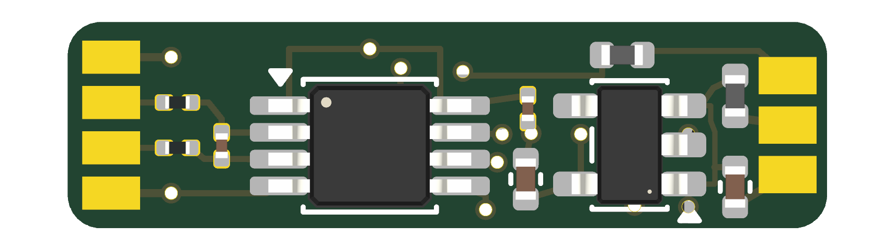
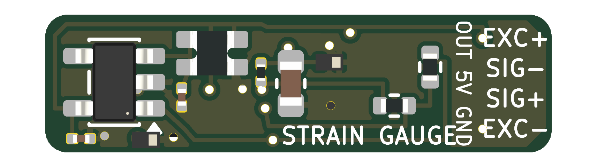
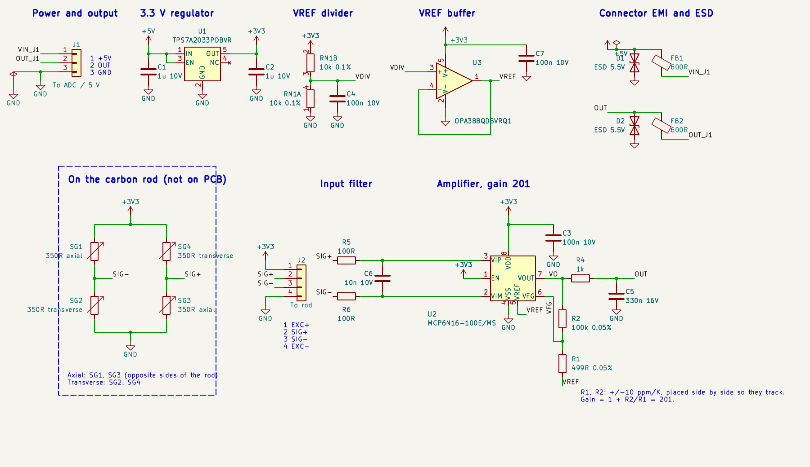
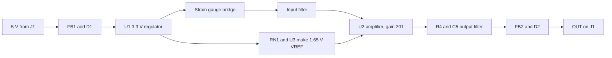
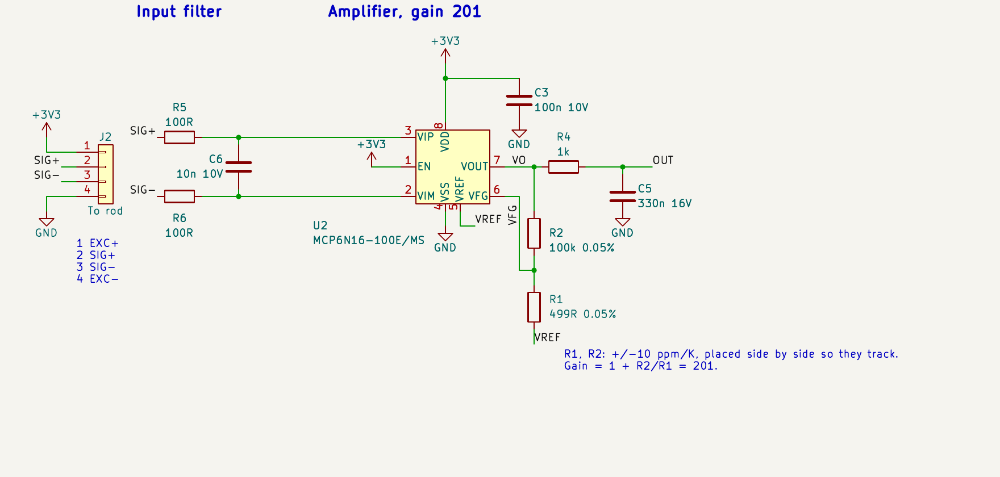

# Strain Gauge Amplifier

A very small analog amplifier board for a full-bridge strain gauge on a carbon rod. It powers the bridge, amplifies the tiny bridge signal by about 201, filters it, and sends one analog voltage to an ADC.

| | |
|---|---|
| Board size | 18.35 × 5.0 mm, 0.8 mm thick, 2 layers |
| Supply | 5 V in, 3.3 V on board |
| Output | Analog, 1.65 V at zero strain |
| Sensitivity | About 0.86 mV/µε at the output |
| Usable range | About ±1850 µε |
| Bandwidth | About 480 Hz |
| Bridge | 350 Ω full bridge, 3.3 V excitation |
| Design tool | KiCad 10 |

Sensitivity and range assume a gauge factor of 2 and a Poisson ratio of 0.3. Replace these with your gauge and rod values when calibrating.

> **Status:** this is a design that passes KiCad's electrical and layout checks. This repository has no test results from a built board. See [Before ordering](#before-ordering).

## The board

**Top side:** amplifier U2, regulator U1, input filter, and ferrites. The gauge pads J2 are on the left and the cable pads J1 are on the right.



**Bottom side:** VREF buffer U3, VREF divider RN1, gain resistors R1 and R2, output filter R4 and C5, and ESD diodes D1 and D2. This view is flipped, so J2 is on the right.



## How it works





### 1. The bridge

Four 350 Ω gauges are bonded to the rod. SG1 and SG3 are axial and sit on opposite sides of the rod. SG2 and SG4 are transverse.

Bending affects the two axial gauges in opposite directions, so it largely cancels. Pure tension or compression adds up. With a 3.3 V supply, the bridge gives about 4.3 µV for each microstrain.

### 2. Power

The 5 V input passes through ferrite FB1, which keeps high-frequency noise out of the regulator. D1 clamps spikes from the cable.

U1 (TPS7A2033) makes the 3.3 V rail. It powers the amplifier and the bridge, and it is also the source for VREF. The bridge draws about 9.4 mA.

### 3. Mid-supply reference

RN1 divides 3.3 V in half, and U3 buffers it to make a low-impedance 1.65 V **VREF**. This sets the amplifier's zero point, so the output can swing both ways for tension and compression on a single supply.

### 4. Input filter

R5, R6, and C6 form a differential low-pass filter with a corner of about 29 kHz, including the bridge resistance. It reduces high-frequency interference picked up on the gauge wires.

### 5. Amplifier



U2 (MCP6N16-100) is a zero-drift instrumentation amplifier. Zero drift means it constantly corrects its own offset, which suits slow, tiny signals like this one.

Two external resistors set the gain:

```
Gain = 1 + R2 / R1 = 1 + 100k / 499 = 201.4
```

The gain depends on the **ratio** of R2 to R1, not their absolute values. They use the same ±10 ppm/K part family and sit next to each other, so their ratio stays stable as temperature changes.

The output is:

```
VOUT = VREF + Gain × (SIG+ − SIG−)
```

### 6. Output

R4 and C5 form a low-pass filter at about 480 Hz. This removes noise above the signal band and isolates the amplifier from the cable. FB2 and D2 add high-frequency blocking and ESD protection at the output.

## Wiring

Use the labels printed on the board, because the J2 pad order is not the same as its pin numbers.

**J2, gauge bridge (top to bottom on the board):**

| Label | Pin | Connects to |
|---|---|---|
| EXC+ | 1 | Bridge top, 3.3 V |
| SIG− | 3 | Junction of SG1 and SG2 |
| SIG+ | 2 | Junction of SG4 and SG3 |
| EXC− | 4 | Bridge bottom, GND |

**J1, cable to the ADC (top to bottom on the board):**

| Signal | Pin | Notes |
|---|---|---|
| OUT | 2 | Analog output |
| +5V | 1 | Power input |
| GND | 3 | Ground |

The `OUT 5V GND` silk label is on the back of the board near J2, not beside J1. Follow the table above when wiring J1.

## Reading the output

Convert the voltage to strain with:

```
strain (µε) = (VOUT − 1.65 V) / 0.00086 V per µε
```

Treat this as a starting point. For real measurements, calibrate the board on the rod with known loads, and measure the zero point at no load.

Both the zero point and the sensitivity follow the 3.3 V rail, and the ADC cannot see that rail through J1. See the first item below.

## Known limitations

- **3.3 V rail drift:** U1 is rated at ±1.5% over temperature. That could move the zero by up to about 25 mV, or roughly 29 µε. This is the largest temperature error in the design.
- **Gauge wires:** J2 has no ESD diodes and no common-mode filter. EXC+ connects directly to the 3.3 V rail.
- **Chopping frequency:** U2 chops at 25 kHz. Strong interference near that frequency, such as from a motor inverter, could mix down into the signal band.
- **ESD diode position:** D1 and D2 sit after the ferrites, and D2 is about 9 mm from J1. Normally they would sit right at the connector.
- **Automotive qualification:** U1 is not AEC-Q100, and the U2 data sheet makes no AEC-Q100 claim.

## Before ordering

- [ ] Confirm R2's AEC-Q200 status and tempco in the Susumu data sheet.
- [ ] Check stock and lead time for R1 and R2.
- [ ] Compare U2's land pattern with Microchip's MSOP-8 package drawing. It was adapted from a VSSOP footprint.
- [ ] Check spacing around U1 with your assembler. Parts are close, and the 5 V link beside FB1 is at the 0.127 mm minimum track width.
- [ ] Review the vias at (115.0, 102.72) and (115.0, 104.48), which sit in or at the edge of pads.

## Bill of materials

The full list with manufacturers, ratings, and sources is in [StrainGauge_BOM.csv](StrainGauge_BOM.csv).

| Ref | Part | Purpose |
|---|---|---|
| U1 | TI TPS7A2033PDBVR | 3.3 V regulator |
| U2 | Microchip MCP6N16-100E/MS | Zero-drift instrumentation amplifier |
| U3 | TI OPA388QDBVRQ1 | VREF buffer |
| R1 | Susumu RG1005N-4990-W-T1, 499 Ω | Gain setting |
| R2 | Susumu RG1005N-104-W-T1, 100 kΩ | Gain setting |
| RN1 | Vishay ACASN1002U1002P1AT, 10k/10k | VREF divider |
| R4 | 1 kΩ | Output filter |
| R5, R6 | 100 Ω | Input filter |
| C1, C2 | 1 µF | Regulator input and output |
| C3, C4, C7 | 100 nF | Decoupling and VREF filtering |
| C5 | 330 nF | Output filter |
| C6 | 10 nF | Input filter |
| FB1, FB2 | Murata BLM15PX601SH1D | Connector EMI filtering |
| D1, D2 | TI TPD1E10B06QDPYRQ1 | ESD protection |

## Files

| File | Contents |
|---|---|
| `StrainGauge.kicad_pro` | KiCad project, open this first |
| `StrainGauge.kicad_sch` | Schematic |
| `StrainGauge.kicad_pcb` | PCB layout |
| `StrainGauge.kicad_sym` | Project symbols |
| `StrainGauge.pretty/` | Project footprints |
| `StrainGauge_BOM.csv` | Bill of materials |
| `StrainGauge_top.png`, `StrainGauge_bottom.png` | Board renders |
| `docs/` | Schematic images used in this README |

## Data sheets

- [MCP6N16 amplifier](https://ww1.microchip.com/downloads/en/DeviceDoc/20005318A.pdf)
- [TPS7A20 regulator](https://www.ti.com/lit/ds/symlink/tps7a20.pdf)
- [ACAS resistor arrays](https://www.vishay.com/doc?28770)
